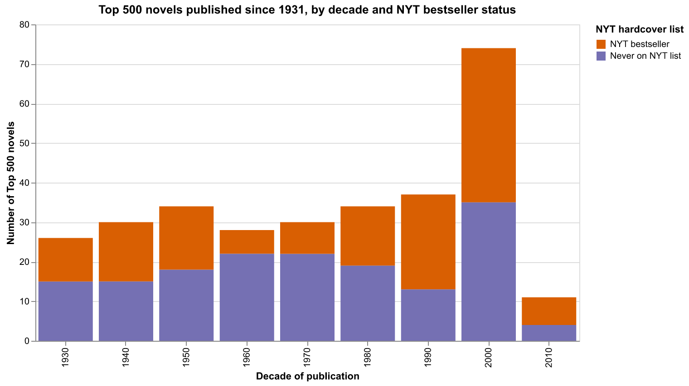
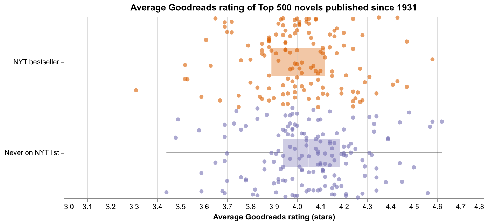
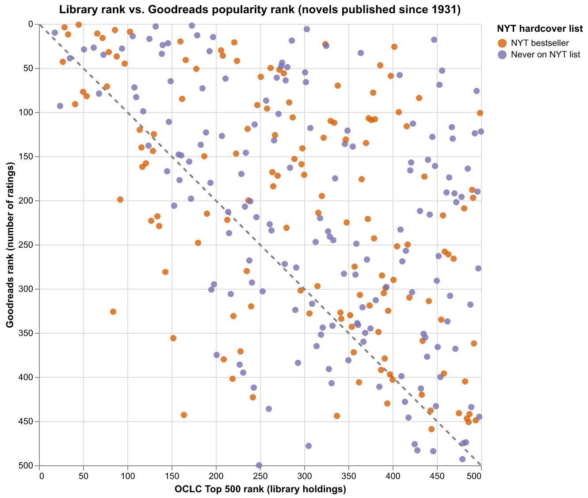

# Bestsellers in the Library Canon (IS310 EDA Homework)

## What this notebook does

[`BestsellersInTheLibraryCanon.ipynb`](BestsellersInTheLibraryCanon.ipynb) explores two cultural datasets together:

- OCLC's **Top 500 "Greatest" Novels** — the 500 novels held by the most libraries, expanded with author, Goodreads, and Project Gutenberg data by Anna Preus and Aashna Sheth ([Responsible Datasets in Context](https://www.responsible-datasets-in-context.com/posts/top-500-novels/top-500-novels.html)).
- The **New York Times Hardcover Fiction Bestsellers, 1931–2020** list, compiled by Jordan Pruett ([Post45 Data Collective](https://data.post45.org/nyt-fiction-bestsellers-data/)).

**Research question:** Which of the Top 500 novels were also NYT bestsellers, and do those bestsellers differ from the rest of the list in when they were published, how Goodreads readers rate them, and who wrote them?

The notebook covers:
1. An introduction to both datasets (provenance and what one row represents)
2. An initial audit (`head()`, `shape`, `dtypes`, `describe()`, missing-value counts)
3. Linking the datasets with a normalized title + author-surname match (the simple `.capitalize()` merge from class only finds 12 matches; this finds 142)
4. Coverage and missing-data issues (the NYT list only starts in 1931 and only covers hardcover adult fiction; 221 missing genres are hidden as the text `"na"`; VIAF records gender as binary)
5. Three Altair charts with interpretation, a gender table, and a conclusion

## Findings in brief

- About 46% of the Top 500 novels published since 1931 were NYT hardcover bestsellers, and the share is highest for novels from the 1990s onward.
- Goodreads ratings are almost the same for bestsellers and non-bestsellers.
- Libraries and Goodreads disagree most on age and audience (older classics vs. recent young-adult books), not on bestseller status.
- Bestsellers on the list are more often by men (73%) than non-bestsellers are (57%), possibly because children's/YA books are not on the adult hardcover list.

## Charts

GitHub does not display interactive Altair charts inside notebooks, so PNG copies are saved in [`charts/`](charts/):





Open the notebook in Jupyter or VS Code to use the tooltips and the clickable legend.

## Data

No data files are stored in this folder. The notebook downloads both datasets from stable remote URLs when it runs (you need an internet connection):

| Dataset | URL |
|---|---|
| Top 500 novels (no full text) | https://raw.githubusercontent.com/melaniewalsh/responsible-datasets-in-context/main/datasets/top-500-novels/final_merged_dataset_no_full_text.tsv |
| NYT bestsellers (weekly list) | https://raw.githubusercontent.com/ecds/post45-datasets/main/nyt_full.tsv |

The 152 MB full-text dataset from Canvas (and `combined_novels_viz.csv`) is **not** needed and should not be committed.

## How to run it

From the root of the `is310-coding-assignments` repository:

1. Activate the virtual environment:
   ```bash
   source .venv/bin/activate
   ```
2. Install the packages (pandas, Altair, vl-convert for saving PNGs, matplotlib for the quick pandas plot, Jupyter):
   ```bash
   pip install -r pandas-eda/requirements.txt
   ```
3. Open the notebook and choose the `.venv` Python as the kernel, then run all cells:
   ```bash
   jupyter notebook pandas-eda/BestsellersInTheLibraryCanon.ipynb
   ```
   Or run it from the command line (re-saves the outputs and the PNGs in `charts/`):
   ```bash
   cd pandas-eda && jupyter nbconvert --to notebook --execute --inplace BestsellersInTheLibraryCanon.ipynb
   ```

Tested with Python 3.9. The virtual environment (`.venv/`) is not part of this folder and should not be committed.

## AI use

I used Claude Code (an AI coding assistant) to help with this assignment. It read the lesson page and dataset documentation, installed the packages, and drafted the notebook's code and structure (building on the in-class code) as well as the interpretation and conclusion text. The interpretation and conclusion text are still largely as the AI drafted them. I am responsible for the final content and any errors.
